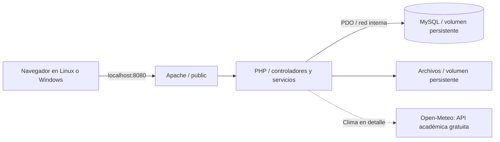

# Arquitectura inicial — B01

## Decisiones adoptadas

- PHP 8.4 + Apache, MySQL 8.4 LTS; imágenes oficiales con digest multi-arquitectura fijado. No usar `latest`.
- PHP organizado por responsabilidades, sin framework para la base inicial; autoload del namespace Eventify. Composer/QR se incorporarán al implementar tickets con versiones bloqueadas.
- PDO MySQL, consultas preparadas nativas, utf8mb4 y hora UTC. Regla de negocio/ER pendientes de B02.
- Docker Compose con web y db; red backend interna, MySQL sin puerto publicado, web local en 127.0.0.1.
- Raíz HTTP `public/`; código interno, configuración y scripts fuera del directorio servido. La imagen no incluye .env.
- Volúmenes separados para MySQL y archivos; arranque/reconstrucción no ejecutan eliminación de datos.
- HTML/CSS y jQuery 4.0.0 locales. Catálogo dinámico y actualización del historial implementados en B05 parcial; integración MySQL pendiente.



## Imágenes resueltas

Digest consultado en el registro oficial Docker Hub durante B01:

```text
php:8.4-apache@sha256:901b0dbcd2419cc9cd307ea05e57403449ce722ccd5b32335da6e8d39f2b1ee0
mysql:8.4@sha256:6ea90827b1100f8f2ae306a539f86d2c264a26ed435a2a9f75551dd5c3aeb242
```

Compatibilidad Windows significa ejecutar estas imágenes Linux a través de Docker Desktop; no construir un backend diferente para Windows. El digest fija la base, no certifica la instalación ni elimina la necesidad de revisar actualizaciones de seguridad. PDO MySQL se compila al construir la imagen.

## Rutas disponibles en B01

| Ruta | Comportamiento |
| --- | --- |
| `/` | Página inicial explícitamente en construcción. |
| `/assets/css/app.css` | Estilos locales. |
| `/salud` | SELECT 1 real por PDO; 200 si conecta, 503 si no; no muestra credenciales/error SQL. |
| Ruta no existente | 404 con enlace al inicio. |
| Método distinto de GET/HEAD en rutas PHP | 405. No hay operaciones de escritura implementadas. |

Al cerrar B01 todavía no había login, categorías, eventos persistidos, reservas, tickets o dashboard; los incrementos posteriores se describen abajo. La página inicial no representa aceptación de RF-04 ni una simulación presentada como sistema terminado.

## Dependencias gratuitas y candidatas

| Componente | Condición | Estado |
| --- | --- | --- |
| PHP / MySQL Community / Apache | Software disponible sin pago para este uso; conservar avisos de licencias aplicables al redistribuir. | Base elegida; ejecutar Docker pendiente. |
| Docker Engine / Compose | Open source; Desktop contempla uso académico gratuito según sus condiciones. | Compose validado de forma portable; daemon no instalado. |
| jQuery 4.0.0 completo | MIT; copia local con licencia, sin CDN en ejecución. | Catálogo/historial preparados y probados con fixtures; MySQL pendiente. |
| chillerlan/php-qrcode 6.0.1 | MIT/Apache-2.0; requiere PHP >=8.2 y mbstring según metadatos de Packagist. | Candidata elegida para B04; instalar/extensiones/lockfile pendientes. |
| PHPUnit 13.4.1 | BSD-3-Clause; requiere PHP >=8.4.1 y extensiones. | Candidato consultado; no instalado. Las pruebas B01 son scripts mínimos sin dependencia externa. |
| Open-Meteo | Modalidad gratuita no comercial; 10.000 llamadas/día, sin garantía de disponibilidad. | Integrada para evaluación no comercial con atribución/caché/límites; prueba real independiente correcta. |

La venta del trabajo de desarrollo no determina por sí sola que la operación futura de la plataforma cumpla una licencia API no comercial. Antes de uso empresarial, revisar condiciones o elegir una API compatible; no convertirlo automáticamente en un servicio de pago.

## Publicación con presupuesto gratuito

- Render gratuito no aporta discos persistentes para un MySQL propio; no es una solución completa confirmada para este stack.
- InfinityFree anuncia PHP 8.4 y MySQL 8.0/MariaDB 11.4, subdominio y SSL gratuitos sin tarjeta. Es una candidata de investigación, no un despliegue seleccionado/validado.
- Confirmar MySQL real (no reemplazarlo por MariaDB sin resolver el requisito), variables/secretos fuera de raíz pública, extensiones, API saliente, cuotas, sesiones, importación y persistencia. Su BD gratuita no permite conexiones externas: PHP y BD deben residir allí.
- Docker puede cubrir ejecución local aunque el proveedor publique archivos PHP sin contenedores; RT-06 exige poder ejecutar con Docker, no que cada proveedor use Compose.
- No crear cuentas ni aceptar términos en esta intervención. No hay URL pública verificada.

## Fuentes de las decisiones

- [Soporte PHP](https://www.php.net/supported-versions.php).
- [MySQL LTS](https://dev.mysql.com/doc/refman/8.4/en/mysql-releases.html).
- [chillerlan/php-qrcode](https://github.com/chillerlan/php-qrcode) y metadatos públicos de Packagist.
- [Open-Meteo: condiciones de planes](https://open-meteo.com/en/pricing).
- [InfinityFree: características anunciadas](https://www.infinityfree.com/).
- [Restricción MySQL externo de InfinityFree](https://forum.infinityfree.com/t/connecting-to-mysql-from-an-external-application/49339).
- [Limitaciones gratuitas de Render](https://render.com/docs/free).

## Dependencia QR adoptada en B04

BaconQrCode 3.1.1 y dasprid/enum 1.0.7 (BSD-2-Clause), composer.lock versionable. SVG generado localmente desde la matriz codificada, sin servicio externo, datos privados ni URL pública en payload. Requiere ctype/iconv y PHP objetivo 8.4; las dependencias por sí mismas admiten ^8.1. Docker descarga Composer 2.10.3 con SHA-256 fijado e instala desde lock con plugins/scripts deshabilitados, comprobando la plataforma real. Vendor no se versiona.

## Catálogo y actualización asincrónica (B05 parcial)

Filtros validados en CatalogFilter, consultas PDO en CatalogRepository, renderizado escapado en fragmentos PHP. Listados de 12 registros, consulta de 13 para detectar siguiente página sin COUNT repetido. Fechas inclusivas en hora Costa Rica traducidas a límites UTC [inicio, día siguiente); comodines LIKE de usuario tratados literalmente. Borradores privados; publicados pasados aparecen como finalizados sin modificar automáticamente la base. Cancelados/finalizados consultables y sin formulario de reserva. Disponibilidad se calcula con reservas CONFIRMADAS.

jQuery: (1) catálogo con debounce, aborto y secuencia que descarta respuestas anteriores incluso mientras el usuario escribe; (2) Mis experiencias con consulta autenticada y actualización tras cancelar. AJAX: GET /api/eventos, POST /api/reservas, POST /api/reservas/{id}/cancelar y GET /api/experiencias. Las rutas de historial/cancelación conservan autorización y CSRF de escritura; las consultas públicas no necesitan sesión. API meteorológica integrada; comprobación con MySQL/imagen objetivo pendiente.

Dependencia: [jQuery 4.0.0 oficial](https://jquery.com/download/), [licencia MIT](https://jquery.com/license/); fuente https://code.jquery.com/jquery-4.0.0.min.js. SHA-256: 39a546ea9ad97f8bfaf5d3e0e8f8556adb415e470e59007ada9759dce472adaa. Archivos locales public/assets/lib/jquery-4.0.0.min.js y jquery-LICENSE.txt; conservar encabezado y licencia.

## API meteorológica y disponibilidad del flujo central

WeatherController busca un evento público mediante CatalogRepository y llama EventWeather. El navegador pide el endpoint AJAX después de renderizar el detalle; la reserva no espera al proveedor ni comparte su sesión/CSRF con él. Endpoint externo fijo api.open-meteo.com/v1/forecast; acepta solamente coordenadas numéricas validadas del evento. WEATHER_ENABLED=false desactiva la integración sin afectar reservas. El stack de pruebas la desactiva para no depender de Internet.

Cliente PHP con TLS verificado, redirects deshabilitados, timeout de lectura 3 s, máximo 128 KiB, JSON/unidades/rangos/fecha revisados. Datos diarios seleccionados por fecha Costa Rica; no se confunden con el clima exacto de la hora del evento. Solo próximos eventos públicos hasta +15 días. Coordenadas se redondean a 4 decimales. Panel usa texto seguro y atribución Open-Meteo/CC BY 4.0, con marca temporal y aviso si se muestra información anterior.

storage/weather queda fuera de Git/raíz web, volumen persistente. Caché 3600 s, backoff 600 s tras fallo/cuota, datos previos máximo 21600 s. Locks no bloqueantes evitan llamadas simultáneas por misma ubicación/fecha; presupuesto común máximo 30 requests/h y 10/min, contando intentos. Si no se puede mantener caché/presupuesto, se presenta indisponibilidad. Archivos son caché descartable; mantenimiento futuro no debe tocar sesiones, credenciales ni MySQL.

Condiciones oficiales consultadas 2026-10-08: API gratuita solo no comercial, menos de 10.000 llamadas/día, 5.000/h y 600/min, límite publicado 300.000/mes; sin garantía de disponibilidad. Datos CC BY 4.0 con atribución. Sin registro/clave/tarjeta ni planes de pago activados. Selección válida para demostración educativa, no promesa de explotación comercial gratuita. Fuentes: [condiciones](https://open-meteo.com/en/terms), [documentación](https://open-meteo.com/en/docs), [planes](https://open-meteo.com/en/pricing).

## Administración de categorías y eventos (B06 parcial)

AdminController autoriza rol desde MySQL en cada petición y verifica CSRF antes de escribir. AdminInput normaliza campos; AdminService coordina transacciones. No se confía en selectores/readonly del navegador. Estado solo por POST y acciones explícitas. Consultas/errores siguen política PDO/escape/redacción del proyecto. Admin consulta borradores; catálogo público no. Listas paginadas (50).

Sin DELETE: categoría se desactiva y evento se cancela conservando reservas/tickets. Cancelado/finalizado son terminales para este alcance. Categorías inactivas pueden conservarse en eventos existentes; no asignarse a nuevos ni sustituir otra categoría. Slug de evento inmutable; fecha y paso a borrador no modificables con historial. Edición precio afecta reservas futuras; unit_price/total histórico no se toca. Cancelar evento no cambia estado ni precio de las reservas existentes.

Lock evento FOR UPDATE compartido con ReservationService, luego categoría FOR SHARE; comprobar suma confirmadas después del bloqueo antes de reducir capacidad. Transiciones cancelado/finalizado con el mismo lock; finalizar exige inicio <= UTC actual. No afirmar resistencia a carrera verificada hasta ejecutar pruebas concurrentes.

Fecha de formularios Costa Rica con precisión segundos, convertida a UTC. No perder segundos de datos sembrados al editar sin cambios. Eventos nuevos/editables deben ser futuros; es decisión de protección. Galería SVG local generada para el proyecto, paths estrictamente permitidos, sin URL libre ni uploads. Esta selección implementa campo imagen; cargas de archivos no forman parte de este incremento.

## Lectura administrativa B06

AdminReadRepository concentra consultas privadas tras comprobar rol ADMINISTRADOR en AdminController. Dashboard: una sola sentencia con CTE para compartir snapshot/instante UTC y no duplicar capacidades por JOIN de reservas; activos D-03, entradas separadas de reservas, SUM(total) histórico DECIMAL y tres derivados. Rankings excluyen cero, empates visibles y menor ID determinista; estado activo no exige categoría activa para conservar actividad de eventos existentes. DashboardMetrics solo redondea porcentaje, nunca dinero.

Reservas: búsqueda literal parcial por evento y por nombre/correo, estado CONFIRMADA/CANCELADA, validación de filtros/cantidad de páginas, orden estable y 50+1 registros. JOIN de ticket por reserva (creados atómicamente), detalle histórico de solo lectura. Caché no-store y rol vigente del servidor; rutas privadas de QR mantienen su regla de propietario. Vistas escapadas y adaptables, sin nueva dependencia/API ni migraciones. Dataset transaccional MySQL e integración HTTP preparados pero sin ejecutar.
