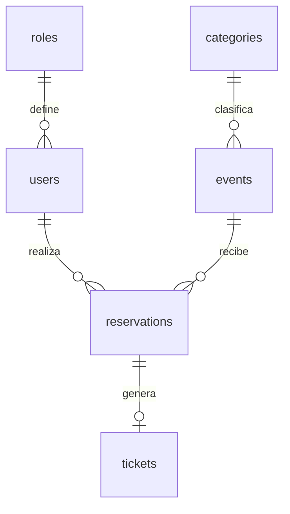

# B02: modelo y operación de datos

Estado: implementado; validación con MySQL real pendiente. Requisitos afectados: RF-01–RF-13, RF-17–RF-21 y RNF-03/RNF-04. Esta base prepara los módulos; B03 prepara pantallas y endpoints de autenticación; reservas y tickets todavía por implementar.

## Relaciones

Las seis tablas de negocio usan InnoDB, claves primarias autoincrementales y claves foráneas con eliminación restringida. `schema_migrations`, `auth_limits` y `demo_seed_runs` registran operaciones técnicas. No hay eliminaciones en cascada del historial.

## Diccionario

| Tabla | Campos y reglas relevantes |
| --- | --- |
| roles | `id` TINYINT; `code` ASCII único y nombre. Roles ADMINISTRADOR/USUARIO creados en migración. |
| users | `id` BIGINT; `role_id`; `full_name` 150; `email` 254 único sin distinguir mayúsculas; `password_hash` 255; `is_active`; fechas de creación/actualización. |
| categories | `id` BIGINT; nombre 120 y slug ASCII 120 únicos; indicador activo y fechas. |
| events | `id`, categoría; slug ASCII único 160; nombre 180; descripción TEXT; ruta de imagen 255; inicio DATETIME; ubicación 255; coordenadas DECIMAL(9,6) opcionales con límites; capacidad INT positiva; precio DECIMAL(12,2) no negativo; estado y fechas. |
| reservations | `id`, usuario/evento; código ASCII único de 32 caracteres; cantidad INT positiva; precio unitario histórico DECIMAL(12,2); total DECIMAL(22,2), igual a precio × cantidad; estado; fecha de cancelación y auditoría temporal. |
| tickets | `id`; reserva única; código ASCII único de 64 caracteres; creación. Un ticket representa la reserva y su cantidad; contenido visual y QR se implementan en B04. |
| schema_migrations | Versión, SHA-256, estado EN_PROCESO/APLICADA, número de sentencias ejecutadas, inicio/finalización. |
| auth_limits | Migración 002: clave HMAC de acción/IP, inicio de ventana y contador; protección persistente de intentos. |
| demo_seed_runs | Identificador de demostración aplicada y fecha; evita sembrar de nuevo. |

El esquema ejecutable y sus longitudes exactas están en `database/migrations/001_initial_schema.php`. Los campos son obligatorios salvo coordenadas, fecha de cancelación y fecha de finalización técnica. Fechas DATETIME en UTC; presentación en America/Costa_Rica. Los importes se guardan como decimales, sin números flotantes para cálculos monetarios de negocio.

## Decisiones y límites

- Evento: BORRADOR, PUBLICADO, CANCELADO o FINALIZADO. Reserva: CONFIRMADA o CANCELADA. Ticket válido se deriva de su reserva y evento; no duplicar un estado que pueda desincronizarse.
- Una reserva confirmada por usuario/evento. La columna generada `active_event_id` y el índice único permiten conservar varias cancelaciones históricas y volver a reservar después de cancelar.
- Cupos disponibles = capacidad menos cantidades confirmadas. Canceladas no ocupan. Últimos espacios cuando disponibles ≤ 20% de capacidad; con cero se presenta agotado.
- Cancelar exige más de 86.400 segundos hasta el inicio; exactamente 24 horas no basta. La política usa instantes, independientemente de la zona horaria.
- La base impide cantidades/precios/totales incoherentes, referencias inexistentes y duplicidad activa. La suma de reservas frente al aforo requiere una transacción y bloqueo del evento en B04; este esquema por sí solo no impide sobreventa.
- Índices de catálogo por estado/fecha y categoría/fecha; ocupación por evento/estado; historial por usuario/fecha. No guardar contadores de disponibilidad redundantes.

## Migraciones y arranque

`start-linux.sh` y `start-windows.ps1` esperan MySQL y ejecutan `php bin/migrate.php`. Repetir el arranque conserva los datos y omite migraciones ya aplicadas con la misma firma. Los archivos aplicados son inmutables; toda modificación futura usa una nueva versión.

MySQL confirma DDL implícitamente. El ejecutor registra progreso y utiliza un bloqueo de aplicación para evitar dos migraciones simultáneas. Si falla una sentencia, conserva el estado EN_PROCESO y bloquea el reintento automático. No se garantiza un rollback global de todas las tablas.

Ante fallo: detener cambios, conservar registros, respaldar la base y revisar las sentencias aplicadas frente al esquema real. Preparar una reparación específica y revisar antes de actualizar el registro técnico. No borrar tablas/volúmenes ni marcar APLICADA sin comprobar el resultado. No existe un reset automático.

## Demostración opcional

Después del arranque, Linux: `bash scripts/demo-linux.sh`. Windows: `powershell -ExecutionPolicy Bypass -File scripts/demo-windows.ps1`.

Inserta tres cuentas ficticias, cuatro categorías, ocho eventos y siete reservas con tickets. Incluye evento gratuito, últimos espacios, agotado, borrador, cancelado, finalizado y próximo a iniciar. Fechas relativas a la primera ejecución; repetir no las mueve. Es una transacción y no modifica datos existentes; un conflicto aborta la operación.

Contraseñas aleatorias: hashes en MySQL y credenciales de evaluación en `/var/www/html/storage/demo-credentials.json`, dentro del volumen privado, fuera de la raíz pública y de Git. El comando no imprime claves. Se permite solo APP_ENV local/test. No es un mecanismo de creación de administradores públicos. La consulta/exportación privada para evaluación se completará con B03.

Si existe un archivo de credenciales sin marca en la base, el sembrador se detiene para revisión. No lo sobrescribe. Si se pierde el archivo tras una siembra exitosa, las cuentas no se recrean ni se cambian sus claves automáticamente.

## Pruebas aisladas

Linux: `bash scripts/test-database-linux.sh`. Windows: `powershell -ExecutionPolicy Bypass -File scripts/test-database-windows.ps1`.

Usan `docker-compose.test.yml`, proyecto `eventify-tests`, base `eventify_test` en memoria temporal, sin puertos ni volúmenes de la aplicación. Al finalizar se retiran únicamente sus contenedores y red; los datos de prueba son efímeros. No ejecutarlas contra una base de negocio.

La suite verifica migraciones repetibles, siembra no destructiva, hashes, cupos derivados, restricciones, historial cancelado, bloqueo de semillas en producción y detección de migraciones alteradas/incompletas. No reemplaza las pruebas de concurrencia ni de permisos de B03/B04.

## Edición administrativa (B06 parcial)

No cambia esquema. Evento actualizado bajo bloqueo FOR UPDATE: capacidad >= entradas confirmadas; slug se conserva. Cualquier historial de reservas fija fecha y prohíbe volver a BORRADOR. Cancelados/finalizados conservan datos y no se reactivan. Cancelar evento no cancela individualmente sus reservas: tickets muestran invalidez por estado del evento, con historial/precio conservados. Finalización explícita solo después del inicio; el catálogo ya trata PUBLICADO pasado como finalizado sin modificar fila automáticamente. Categoría desactivada conserva referencias; no se asigna a un nuevo evento. Precio nuevo no actualiza unit_price/total de reservas. Confirmar estas reglas en MySQL y carreras antes de cierre.
